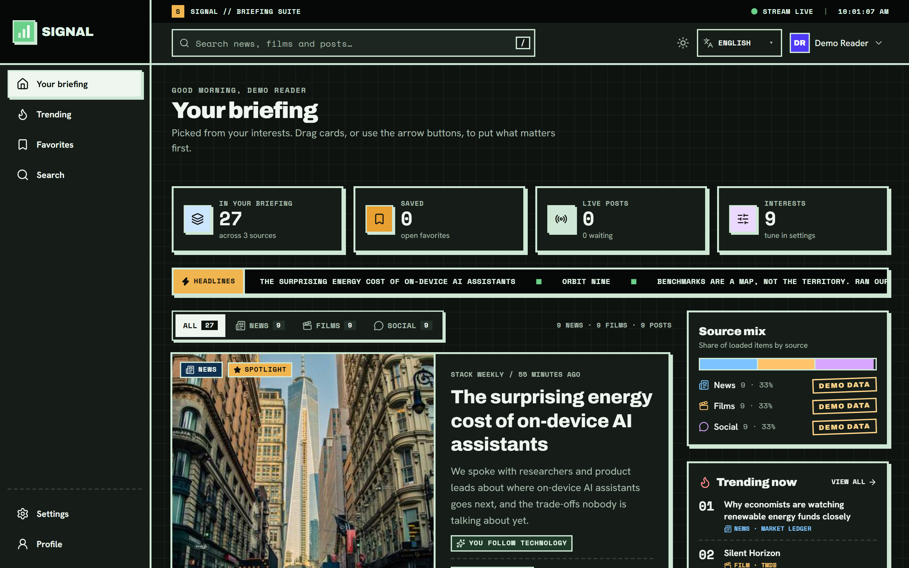

<div align="center">


A personalized content dashboard bringing **news, film recommendations, and social posts** into one customizable feed — wrapped in a bold neo-brutalist operations-console interface.

[](https://nextjs.org/)
[](https://react.dev/)
[](https://www.typescriptlang.org/)
[](https://tailwindcss.com/)
[](https://redux-toolkit.js.org/)
[](https://supabase.com/)

[Explore Repository](https://github.com/ashwin8332/Signal) · [Report a Bug](https://github.com/ashwin8332/Signal/issues) · [Request a Feature](https://github.com/ashwin8332/Signal/issues)

</div>

---

## Contents

- [Overview](#overview)
- [Dashboard Preview](#dashboard-preview)
- [Features](#features)
- [Technology Stack](#technology-stack)
- [Architecture](#architecture)
- [Getting Started](#getting-started)
- [Environment Variables](#environment-variables)
- [Supabase Setup](#supabase-setup)
- [Available Scripts](#available-scripts)
- [Testing](#testing)
- [Security](#security)
- [Accessibility and Performance](#accessibility-and-performance)
- [Deployment](#deployment)
- [Project Structure](#project-structure)
- [Documentation](#documentation)
- [Known Limitations](#known-limitations)
- [Contributing](#contributing)
- [License](#license)

---

## Overview

**Signal** is a personalized content dashboard designed to make content discovery feel like a focused briefing rather than an endless stream. It unifies news headlines, movie recommendations, and hashtag-based social posts in a single feed that readers can personalize, search, reorder, and save.

Signal uses a modern full-stack TypeScript architecture, Next.js Route Handlers as a backend-for-frontend, Redux Toolkit and RTK Query for state and data fetching, and optional Supabase persistence for accounts and favorites.

**Try it without API keys:** Deterministic mock providers supply news, film, and social content out of the box. Add valid NewsAPI and TMDB credentials to enable live news and movie data.

## Dashboard Preview



---

## Features

### Personalized Discovery

- Customize interests across news categories, film genres, and social hashtags.
- Browse a unified feed with normalized cards for different content types.
- See why a recommendation appears, such as a followed category, preferred genre, or current trend.
- Explore Trending and Favorites views.

### Feed Controls

- Reorder content using drag-and-drop.
- Use keyboard-accessible move controls as an alternative to dragging.
- Filter the feed by source and inspect source counts.
- Load additional content through infinite scrolling, with a manual **Load more** fallback.
- Save favorites with optimistic updates and undo support.

### Search

- Search across supported content categories.
- Debounce input to avoid unnecessary requests.
- Navigate to search results using a shareable URL.

### Live Updates and Source Health

- Receive new feed posts using Server-Sent Events (SSE).
- Queue new items behind a **new posts** indicator so the page does not jump while you read.
- Monitor stream states and see whether each provider is using live API data, demo data, or is unavailable.
- Continue using healthy sources when another integration fails.

### Account and Preferences

- Sign up, log in, log out, and manage a profile.
- Persist interests and feed order in browser localStorage.
- Optionally persist accounts and favorites using Supabase.
- Switch between light and dark themes.
- Use the interface in English, Spanish, French, German, Portuguese, and Hindi.

### Interface and Accessibility

- Neo-brutalist styling with strong borders, offset shadows, grid-paper details, and square corners.
- Responsive sidebar, icon rail, and mobile navigation drawer.
- Respect `prefers-reduced-motion`.
- Support keyboard navigation, visible focus states, semantic landmarks, and screen-reader announcements.

---

## Technology Stack

### Frontend

| Technology | Purpose |
|---|---|
| **Next.js 16 App Router** | Application framework, routing, server rendering, and Route Handlers |
| **React 19** | Component-based user interface |
| **TypeScript (strict)** | Static typing and safer application logic |
| **Tailwind CSS 4** | Responsive styling and design tokens |
| **Redux Toolkit** | Client-side state management |
| **RTK Query** | API caching, request deduplication, pagination, and feed fetching |
| **Framer Motion** | Transitions, hover effects, and layout animation |
| **React DnD** | Drag-and-drop feed reordering |
| **react-i18next** | Translation and internationalization |
| **Zod** | Runtime validation of inputs and persisted data |
| **Lucide React** | Interface icons |

### Backend and Data

| Technology | Purpose |
|---|---|
| **Next.js Route Handlers** | Backend-for-frontend API layer |
| **Node.js** | Server-side JavaScript runtime |
| **Supabase** | Optional managed database integration |
| **PostgreSQL** | Persistent data store through Supabase |
| **Server-Sent Events (SSE)** | Live feed updates |
| **scrypt** | Password hashing |
| **HMAC-SHA256** | Signing and verifying session tokens |
| **HTTP-only cookies** | Session storage |
| **Zod** | Request validation and allow-list enforcement |

> **Authentication note:** Signal uses application-managed authentication and signed session cookies. Supabase provides persistent storage when configured; Supabase Auth is not the authentication mechanism described in this project.

### APIs and Content Providers

| Provider | Purpose | API key required? |
|---|---|---|
| **NewsAPI** | Live headlines and news search | Yes, for live news |
| **TMDB** | Film discovery and recommendations | Yes, for live films |
| **Mock news provider** | Deterministic fallback headlines | No |
| **Mock movie provider** | Deterministic fallback film data | No |
| **Mock social provider** | Hashtag-based social posts | No |
| **Supabase** | Persistent accounts and favorites | Only when enabling Supabase storage |

### Testing and Quality

| Tool | Purpose |
|---|---|
| **Vitest** | Unit and integration tests |
| **Testing Library** | UI and component behavior |
| **Playwright** | End-to-end browser tests |
| **axe** | Automated accessibility checks |
| **ESLint** | Linting and code-quality checks |
| **TypeScript** | Type checking |
| **GitHub Actions** | Continuous integration |

### Tooling and Deployment

- **npm** — package management and scripts.
- **Turbopack** — development bundling.
- **Git and GitHub** — source control and collaboration.
- **Vercel** — deployment target.

---

## Architecture

Signal follows a **backend-for-frontend (BFF)** pattern. The browser communicates with Next.js Route Handlers rather than calling third-party providers directly. The server validates inputs, keeps credentials private, normalizes responses, and handles provider failures.

```text
┌──────────────────────────────────────────────────────────┐
│                    Browser / Frontend                    │
│                                                          │
│  Next.js · React · TypeScript · Tailwind CSS             │
│  Redux Toolkit · RTK Query · Framer Motion · React DnD   │
│                                                          │
│  Feed · Search · Preferences · Favorites · Profile        │
└──────────────────────────┬───────────────────────────────┘
                           │ REST / SSE
┌──────────────────────────▼───────────────────────────────┐
│                  Next.js BFF / Server                    │
│                                                          │
│  Validation · Authentication · Caching · Rate Limiting   │
│                                                          │
│  /api/news          /api/recommendations                 │
│  /api/social        /api/search                          │
│  /api/trending      /api/favorites                       │
│  /api/stream        /api/health                          │
└──────────────┬────────────────┬──────────────────────────┘
               │                │
       ┌───────▼──────┐  ┌──────▼────────┐
       │   NewsAPI    │  │     TMDB      │
       │ or mock data │  │  or mock data │
       └──────────────┘  └───────────────┘

┌──────────────────────────────────────────────────────────┐
│                    Persistence                           │
│                                                          │
│  localStorage                 Supabase / PostgreSQL      │
│  Interests & feed order       Accounts & favorites       │
│  Device-specific settings     Optional cloud storage     │
└──────────────────────────────────────────────────────────┘
```

### Design Decisions

- **Normalized content:** Providers are mapped into a common content-item shape for a unified feed.
- **Server-side integrations:** Third-party credentials remain on the server.
- **Resilient sources:** A failing provider can fall back to clearly labelled demo data without blanking the entire feed.
- **RTK Query:** Server state is cached and deduplicated; feed pagination uses an infinite-query workflow.
- **Client-state persistence:** Whitelisted preferences are validated and persisted with debounced writes.
- **Non-disruptive streaming:** New SSE events are queued until the reader chooses to display them.

---

## Getting Started

### Prerequisites

- **Node.js:** 20.9 or newer; Node.js 22 is recommended.
- **npm**
- **Git**

### 1. Clone the Repository

```bash
git clone https://github.com/ashwin8332/Signal.git
cd Signal
```

### 2. Install Dependencies

```bash
npm install
```

### 3. Configure Environment Variables

Create your local environment file:

```bash
cp .env.example .env.local
```

On Windows PowerShell:

```powershell
Copy-Item .env.example .env.local
```

You can leave optional API and Supabase credentials unset to use the demo providers and in-memory storage.

### 4. Start the Development Server

```bash
npm run dev
```

Open [http://localhost:3000](http://localhost:3000).

From the landing page, choose the live demo or create an account. The dashboard is available at `/dashboard`.

For seeded demo credentials, inspect `DEMO_USER` in `src/lib/server/users.ts`.

---

## Environment Variables

| Variable | Description | Required? |
|---|---|---|
| `NEWS_API_KEY` | NewsAPI credentials for live headlines and search | Optional |
| `TMDB_API_READ_TOKEN` | TMDB v4 read token; preferred option | Optional |
| `TMDB_API_KEY` | Alternative TMDB v3 API key | Optional |
| `SUPABASE_URL` | Supabase project URL | Optional |
| `SUPABASE_SECRET_KEY` | Server-side Supabase secret key | Optional |
| `AUTH_SECRET` | Secret used to sign session cookies; use 32+ characters in production | Required in production |
| `LIVE_FEED_INTERVAL_MS` | Live stream interval in milliseconds; default `20000` | Optional |

Example `.env.local`:

```dotenv
NEWS_API_KEY=
TMDB_API_READ_TOKEN=
TMDB_API_KEY=

SUPABASE_URL=
SUPABASE_SECRET_KEY=

AUTH_SECRET=replace-with-a-long-random-secret-before-production
LIVE_FEED_INTERVAL_MS=20000
```

Use a strong, unique production secret. Never commit `.env.local`, put secrets in `NEXT_PUBLIC_` variables, or expose server credentials to client-side code.

---

## Supabase Setup

Supabase enables persistent account and favorites storage. The application can still run without it.

1. Create a project at [Supabase](https://supabase.com/).
2. Open the project's **SQL Editor**.
3. Execute `supabase/migrations/0001_users_and_favorites.sql`.
4. Set `SUPABASE_URL` and `SUPABASE_SECRET_KEY` in `.env.local`.
5. Restart the application.
6. Visit `/api/health` to inspect the integration status.

### Storage Behavior

| Data | Storage |
|---|---|
| Accounts | Supabase when configured; otherwise server memory |
| Favorites | Supabase when configured; otherwise server memory |
| Interests and categories | Browser localStorage |
| Feed ordering | Browser localStorage |
| Profile preferences | Browser localStorage |
| Live feed events | SSE stream |

**Important:** Without Supabase, in-memory accounts and favorites reset when the server restarts. Preferences and feed order remain device-specific even when Supabase is enabled.

Keep the Supabase secret key server-side and review the migration's row-level security policies before production use.

---

## External APIs

### NewsAPI

1. Register at [newsapi.org/register](https://newsapi.org/register).
2. Add your API key to `.env.local`:

```dotenv
NEWS_API_KEY=your_newsapi_api_key
```

Without a working key, Signal uses demo news data.

### TMDB

1. Create an account and visit [TMDB API Settings](https://www.themoviedb.org/settings/api).
2. Configure either the v4 read token or the v3 API key:

```dotenv
TMDB_API_READ_TOKEN=your_tmdb_api_read_token
```

Alternatively:

```dotenv
TMDB_API_KEY=your_tmdb_v3_api_key
```

Without a valid credential, Signal uses demo film data.

### Social Content

Social posts are currently generated by a deterministic mock provider. A third-party social API key is not required.

---

## API Routes

| Endpoint | Purpose |
|---|---|
| `/api/news` | Category-based news retrieval |
| `/api/recommendations` | Movie recommendations |
| `/api/social` | Hashtag-based social posts |
| `/api/search` | Search across content types |
| `/api/trending` | Trending news and films |
| `/api/favorites` | Retrieve and update saved items |
| `/api/stream` | Server-Sent Events for live updates |
| `/api/health` | Integration and storage health status |
| Authentication routes | Signup, login, and logout |

Requests are validated at the server boundary. External providers are accessed server-side, and failures can be reported separately so healthy sources remain usable.

---

## Available Scripts

| Command | Description |
|---|---|
| `npm run dev` | Start the development server with Turbopack |
| `npm run build` | Build the production application |
| `npm start` | Run the production server |
| `npm run typecheck` | Run `tsc --noEmit` |
| `npm run lint` | Run ESLint |
| `npm test` | Run unit and integration tests |
| `npm run test:coverage` | Run tests with coverage reporting |
| `npm run test:e2e` | Run Playwright end-to-end tests |
| `npm run test:all` | Run the full verification sequence |
| `npm run screenshots` | Regenerate dashboard screenshots |

---

## Testing

Signal uses several layers of testing.

| Layer | Tools | Coverage Focus |
|---|---|---|
| Unit | Vitest | Feed ordering, reducers, persistence, validation, sessions, and mock providers |
| API integration | Vitest and Next.js request objects | Validation, authentication, cookies, rate limits, and error responses |
| UI integration | Testing Library | Loading states, search, filters, favorites, feed updates, and keyboard reordering |
| End-to-end | Playwright | Authentication flows, navigation, infinite scrolling, drag-and-drop, themes, and persistence |
| Accessibility | axe | Automated accessibility scans in light and dark themes |

Install the Playwright Chromium browser if needed:

```bash
npx playwright install chromium
```

Run the complete verification suite:

```bash
npm run test:all
```

Tests are designed to use deterministic demo providers and do not require live API keys.

---

## Security

Signal includes application-level safeguards such as:

- Server-only storage of third-party credentials.
- Signed session tokens with expiration and verification.
- HTTP-only and SameSite session cookies.
- Scrypt password hashing with per-user salts.
- Constant-time session signature comparison.
- Input validation with Zod allow-lists.
- Origin checks for authentication POST requests.
- Authentication rate limiting.
- Content Security Policy with per-request nonces.
- Open-redirect validation.
- Validation of localStorage data before use.

Before production deployment, configure a strong `AUTH_SECRET`, use HTTPS, keep credentials private, and review the documented threat model.

See [`docs/06-security.md`](docs/06-security.md).

---

## Accessibility and Performance

### Accessibility

- Semantic landmarks and a skip link.
- Visible keyboard focus indicators.
- Keyboard and touch alternatives to drag-and-drop.
- Screen-reader announcements when cards are reordered.
- Reduced-motion support.
- Accessible form labels and validation feedback.
- Automated axe checks in end-to-end tests.

### Performance

- RTK Query caching and request deduplication.
- Debounced search.
- Paginated fetching and infinite scrolling.
- Parallel retrieval of enabled content sources.
- Server-side caching of upstream calls.
- Fixed image frames to minimize layout shifts.
- Skeleton loading states.
- Live stream pausing when the tab is hidden.
- Graceful handling of individual provider failures.

---

## Deployment

Signal can be deployed to [Vercel](https://vercel.com/).

1. Create and configure a Supabase project if persistent storage is needed.
2. Run `supabase/migrations/0001_users_and_favorites.sql` in the Supabase SQL Editor.
3. Import the GitHub repository into Vercel.
4. Configure `AUTH_SECRET` and, when using Supabase, `SUPABASE_URL` and `SUPABASE_SECRET_KEY`.
5. Add NewsAPI and TMDB credentials if live external content is required.
6. Deploy the project.
7. Check `/api/health` to verify integration and storage status.

See [`docs/08-deployment.md`](docs/08-deployment.md) for the deployment checklist.

---

## Project Structure

```text
Signal/
├── src/
│   ├── app/
│   │   ├── api/          # Backend-for-frontend endpoints
│   │   ├── (auth)/       # Authentication pages
│   │   └── (dashboard)/  # Dashboard pages
│   ├── components/       # UI, layout, content, feed and search
│   ├── features/         # Redux slices and selectors
│   ├── services/         # RTK Query API services
│   ├── store/            # Redux store and persistence
│   ├── lib/              # Shared utilities and server providers
│   ├── hooks/            # Shared React hooks
│   └── i18n/             # Internationalization
├── public/
│   └── screenshots/
│       ├── Screenshot 2026-10-16 114518.png
│       ├── dashboard-light.png
│       └── dashboard-dark.png
├── supabase/
│   └── migrations/
├── tests/
│   ├── unit/
│   └── integration/
├── e2e/
├── docs/
├── .github/
│   └── workflows/
├── .env.example
└── package.json
```

This is a high-level overview; consult the repository for the exact current file layout.

---

## Documentation

- [Product Brief](docs/01-product-brief.md)
- [User Stories and Acceptance Criteria](docs/02-user-stories.md)
- [UI Specification](docs/03-ui-spec.md)
- [Architecture and ADRs](docs/04-architecture.md)
- [API Contract](docs/05-api.md)
- [Security and Threat Model](docs/06-security.md)
- [Testing Strategy](docs/07-testing.md)
- [Deployment Guide](docs/08-deployment.md)

---

## Known Limitations

- Social content is mocked; it is not currently sourced from a live social network.
- Live news and film recommendations depend on valid provider credentials and service availability.
- API limits or upstream failures can trigger labelled demo-data fallbacks.
- Without Supabase, in-memory accounts and favorites reset when the server restarts.
- Interests, feed order, and profile preferences are stored per device rather than cloud-synced.
- The custom authentication implementation should be reviewed against the needs of the intended production environment.

---

## Contributing

Contributions, issues, and feature suggestions are welcome.

1. Fork the repository.
2. Create a branch for your change.
3. Implement the change and add or update tests.
4. Run the relevant checks, such as `npm run typecheck`, `npm run lint`, and `npm run test:all`.
5. Open a pull request describing the change.

For bugs and feature requests, use [GitHub Issues](https://github.com/ashwin8332/Signal/issues).

---

## License

No license is specified here. Add a `LICENSE` file to the repository if you intend to grant permissions for others to use, modify, or distribute this project.

---

<div align="center">

**Built by [Ashwin Vincent Koonissery](https://github.com/ashwin8332)**

[GitHub Repository](https://github.com/ashwin8332/Signal) · [Portfolio](https://avkdev.vercel.app)

*Signal — less noise, more signal.*

</div>
